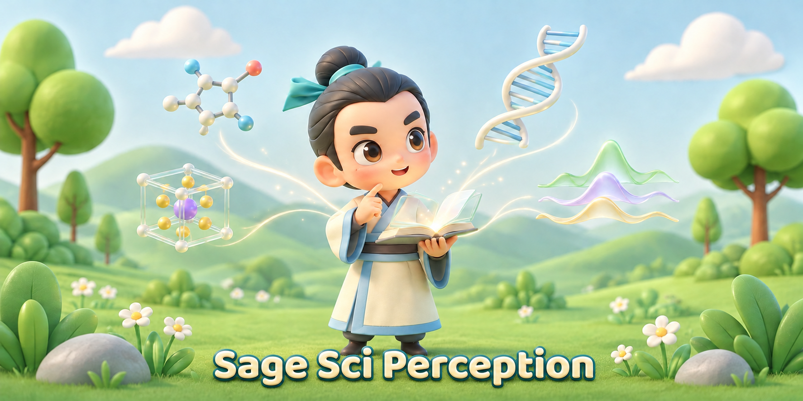
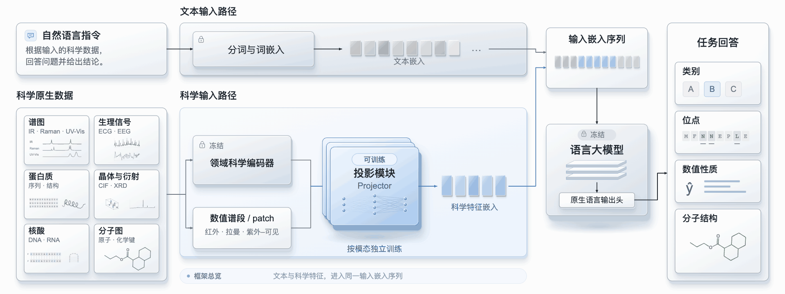
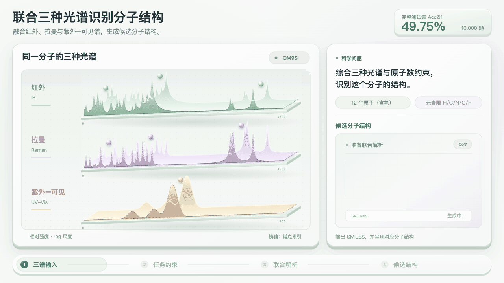
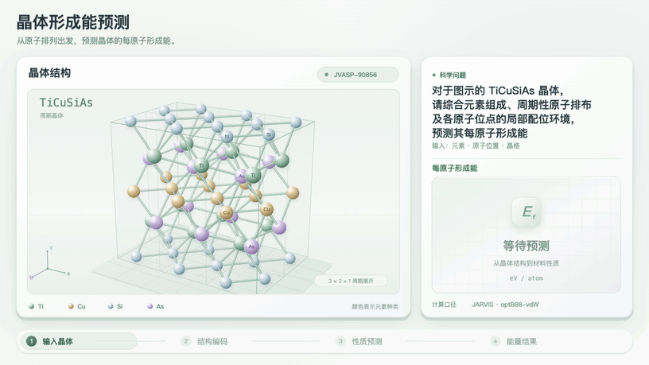

  

<h1 align="center">Sage-SciPerception</h1>

<strong>Sage Sci Perception · 书生·元征</strong>

Scientific perception for language models.

<strong>English</strong> · <a href="README_zh.md">简体中文</a>

  <a href="https://huggingface.co/internlm/Sage-SciPerception">🤗 Models</a> ·
  <a href="https://github.com/InternLM/Sage-SciPerception">GitHub</a> ·
  <a href="#demos">Demos</a> ·
  <a href="#results">Results</a>

## Introduction

Sage Sci Perception (书生·元征) connects scientific encoders to a language model through trainable projectors. It maps molecular graphs, spectra, crystal structures, protein and nucleic-acid sequences, and scientific signals into the language model's input space, enabling natural-language analysis and structured scientific answers. Projectors are trained for each task.

## Framework

  

## Demos

<table width="100%">
  <tr>
    <td width="50%" align="center">
       
      <b>Three spectra → molecular structure</b> 
      IR, Raman and UV–Vis with streamed analysis and a recorded prediction.
    </td>
    <td width="50%" align="center">
       
      <b>Protein interface sites</b> 
      Sequence positions and reference residue-level annotations.
    </td>
  </tr>
  <tr>
    <td width="50%" align="center">
       
      <b>Crystal structure and formation energy</b> 
      Atomic geometry and a reference material property.
    </td>
    <td width="50%" align="center">
       
      <b>RNA interface refinement</b> 
      Design revisions guided by experimental feedback.
    </td>
  </tr>
</table>

## Results

Selected results from task-specific checkpoints, evaluated on generated answers.

| Benchmark | Task | Metric ↑ | Score |
|---|---|---|---:|
| QM9S | Joint-spectrum structure identification | Acc@1 (%) | **49.75** |
| JARVIS-DFT | Formation-energy prediction | MAD/MAE | **15.03** |
| MPBind, assembly-1 reconstruction | PPI interface sites | Mean per-protein F1 (%) | **61.12** |
| SciTS PHU01 | ECG classification | Macro-F1 (%) | **71.53** |
| SciTS NEU06 | Sleep staging | Macro-F1 (%) | **72.01** |
| BEACON ncRNA | RNA family classification | Accuracy (%) | **97.35** |

## Models

Projector checkpoints will be available on [Hugging Face](https://huggingface.co/internlm/Sage-SciPerception).
