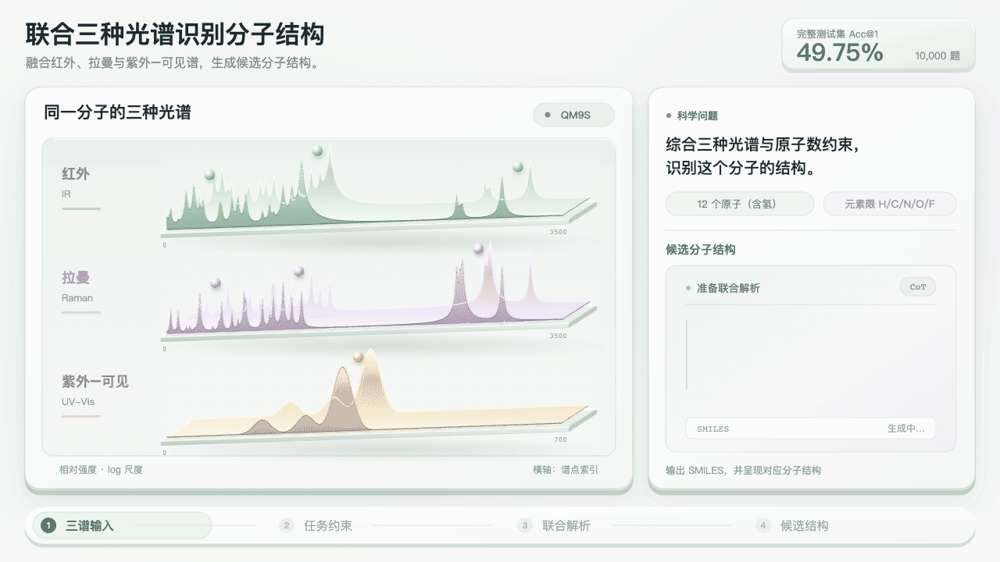
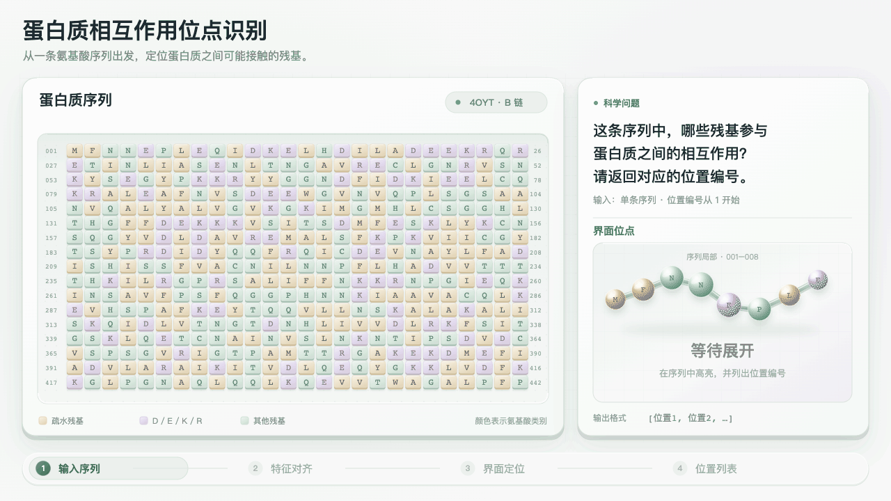
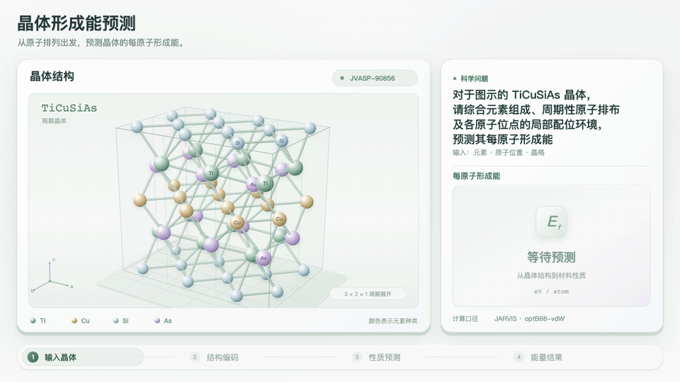
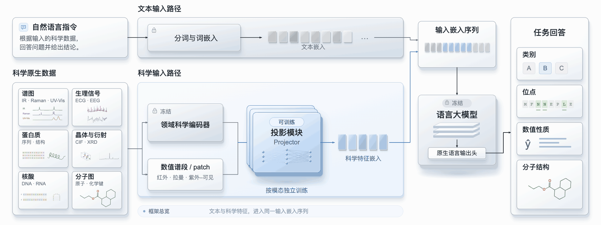

<h1 align="center">书生·元征</h1>
<p align="center"><strong>Sage Sci Perception · 让大模型感知科学数据。</strong></p>
<p align="center">通过投影模块，将晶体、谱图、生物序列与生理信号接入语言模型。</p>
<p align="center"><strong>持续扩展科学模态、任务与语言模型支持。</strong></p>

<p align="center">
  <a href="#快速开始">快速开始</a> ·
  <a href="https://huggingface.co/internlm/Sage-SciPerception">🤗 模型权重</a> ·
  <a href="#示例展示">示例展示</a> ·
  <a href="#评测结果">评测结果</a> ·
  <a href="https://github.com/InternLM/Sage-SciPerception/issues/new">反馈</a> ·
  <a href="https://github.com/InternLM/Sage-SciPerception">English</a>
</p>

<p align="center">
  
</p>

书生·元征（Sage Sci Perception）将科学编码器状态、谱图片段与科学读出映射到语言模型的输入嵌入，使其能够生成自然语言分析和结构化科学答案。你可以通过任务专用 projector，探索分子结构识别、材料性质预测、生物序列分析与生理信号分类。

**从本仓库的工具开始使用，在 [Hugging Face](https://huggingface.co/internlm/Sage-SciPerception) 获取配套权重和配置。** 下载工具通过仓库索引选择 checkpoint，并从同一版本获取任务配置与权重。你可以在 CPU 上检查模块加载，再通过 [vLLM 示例](examples/vllm_cif.py)将已准备好的科学特征接入语言模型服务。从下方的[快速开始](#快速开始)完成首次 CPU 加载。

## 示例展示

以下为科学输入、参考标注与任务界面的录制展示。各 checkpoint 的生成答案评测见[评测结果](#评测结果)。

<table width="100%">
  <tr>
    <td width="50%" align="center">
      <br>
      <b>三谱联合 → 分子结构</b><br>
      <sub>红外、拉曼与紫外—可见光谱，配合流式解析和历史预测回放。</sub>
    </td>
    <td width="50%" align="center">
      <br>
      <b>蛋白质界面位点</b><br>
      <sub>序列位置与逐残基界面参考标注。</sub>
    </td>
  </tr>
  <tr>
    <td width="50%" align="center">
      <br>
      <b>晶体结构与形成能</b><br>
      <sub>原子几何结构与材料性质参考值。</sub>
    </td>
    <td width="50%" align="center">
      <br>
      <b>RNA 接入方案迭代</b><br>
      <sub>根据实验反馈修订接入方案。</sub>
    </td>
  </tr>
</table>

## 快速开始

下载任务专用 projector，并在 CPU 上检查加载。这一步无需下载语言模型或准备 GPU。

```bash
git clone https://github.com/InternLM/Sage-SciPerception.git
cd Sage-SciPerception
python -m pip install -r requirements.txt
python load_projector.py glm-5.3-flash/cif/jarvis --local-dir ./checkpoints
```

所选 checkpoint、任务配置与仓库索引会保存到 `checkpoints/`。更换任务或语言模型版本时，使用 [HF 组件索引](https://huggingface.co/internlm/Sage-SciPerception/blob/main/projectors/glm-5.3-flash/README.md)中的对应 ID。[下载工具](load_projector.py)也提供 `download_projector(...)`，可在 Python 中调用。

在仓库目录运行以下代码，检查 CPU 加载：

```python
from load_projector import load_projector

projector, config = load_projector(
    "checkpoints/projectors/glm-5.3-flash/cif/jarvis", device="cpu"
)
print(config["task"])
print(sum(p.numel() for p in projector.parameters()))
print(config["output_dim"])
```

预期输出：

```text
cif/jarvis
4314304
4096
```

## 通过 vLLM 推理

推理时，将 projector 输出的科学向量插入语言模型的完整聊天提示词嵌入，再通过 `prompt_embeds` 发给 vLLM 的 `/v1/completions`。科学特征与投影在客户端准备，语言模型服务负责生成答案。

### 启动语言模型服务

先在兼容的推理环境中安装 [vLLM](https://docs.vllm.ai/en/latest/getting_started/installation/)。使用所选权重 `config.json` 中指定的精确语言模型快照。在具备相应 GPU 的推理环境中运行 vLLM，并按模型与硬件选择张量并行度；以下命令以八路并行为例：

```bash
vllm serve /path/to/matching-base-model \
  --served-model-name sage-sciperception \
  --enable-prompt-embeds \
  --tensor-parallel-size 8 \
  --generation-config vllm \
  --max-model-len 8192 \
  --host 127.0.0.1 --port 8000
```

### 从已准备的晶体特征生成答案

[晶体客户端](examples/vllm_cif.py)会渲染 checkpoint 的原生 chat template，读取文本嵌入、插入科学向量，并将完整提示词嵌入发送给服务端。准备 `cif_features.pt`：这是形状为 `[num_atoms, 64]` 的张量，内容为 `cif/jarvis/config.json` 指定的真实 CHGNet 0.3.0 原子状态，保持原子顺序。服务就绪后运行：

```bash
python -m pip install --upgrade transformers
python examples/vllm_cif.py \
  --component ./checkpoints/projectors/glm-5.3-flash/cif/jarvis \
  --base-model /path/to/matching-base-model \
  --features /path/to/cif_features.pt \
  --api-base http://127.0.0.1:8000/v1 \
  --model sage-sciperception
```

本地语言模型目录提供与服务端一致的 tokenizer、配置和分片输入嵌入表。客户端只读取所需文本嵌入行，无需加载完整语言模型。服务接口见 [vLLM prompt embedding 文档](https://docs.vllm.ai/en/latest/features/prompt_embeds/)，发布说明见 [HF 推理指南](https://huggingface.co/internlm/Sage-SciPerception/blob/main/README_zh.md#推理使用)。

科学特征提取与任务适配科学模型是独立依赖，部分配套科学权重尚未在此发布；准备预测时需匹配各任务的 `scientific_inputs`。晶体示例从已准备好的特征开始，其他任务需要各自的输入准备与提示词组装。

## 评测结果

得分来自各任务选定 checkpoint 的生成答案。每个 checkpoint 对应各自任务和科学输入表示。

| 榜单 / 任务 | 指标 ↑ | 得分 | 权重 |
|---|---|---:|---|
| [JARVIS-DFT](https://huggingface.co/internlm/Sage-SciPerception/tree/main/projectors/glm-5.3-flash/cif/jarvis)<br>形成能预测 | MAD/MAE | **15.03** | [文件](https://huggingface.co/internlm/Sage-SciPerception/tree/main/projectors/glm-5.3-flash/cif/jarvis) |
| [MPBind](https://huggingface.co/internlm/Sage-SciPerception/tree/main/projectors/glm-5.3-flash/protein-seq/mpbind)<br>PPI 界面位点 | 逐蛋白 F1（%） | **61.12** | [文件](https://huggingface.co/internlm/Sage-SciPerception/tree/main/projectors/glm-5.3-flash/protein-seq/mpbind) |
| [QM9S](https://huggingface.co/internlm/Sage-SciPerception/tree/main/projectors/glm-5.3-flash/spectra/qm9s)<br>分子结构识别 | Acc@1（%） | **49.75** | [文件](https://huggingface.co/internlm/Sage-SciPerception/tree/main/projectors/glm-5.3-flash/spectra/qm9s) |
| [SciTS PHU01](https://huggingface.co/internlm/Sage-SciPerception/tree/main/projectors/glm-5.3-flash/ecg/phu01)<br>心电分类 | 宏平均 F1（%） | **71.53** | [文件](https://huggingface.co/internlm/Sage-SciPerception/tree/main/projectors/glm-5.3-flash/ecg/phu01) |
| [GUE splice](https://huggingface.co/internlm/Sage-SciPerception/tree/main/projectors/glm-5.3-flash/dna/splice)<br>剪接位点分类 | MCC（%） | **87.87** | [文件](https://huggingface.co/internlm/Sage-SciPerception/tree/main/projectors/glm-5.3-flash/dna/splice) |
| [SciTS NEU06](https://huggingface.co/internlm/Sage-SciPerception/tree/main/projectors/glm-5.3-flash/eeg/neu06)<br>睡眠分期 | 宏平均 F1（%） | **72.01** | [文件](https://huggingface.co/internlm/Sage-SciPerception/tree/main/projectors/glm-5.3-flash/eeg/neu06) |
| [BEACON ncRNA](https://huggingface.co/internlm/Sage-SciPerception/tree/main/projectors/glm-5.3-flash/rna/ncrna)<br>RNA 家族分类 | 准确率（%） | **97.35** | [文件](https://huggingface.co/internlm/Sage-SciPerception/tree/main/projectors/glm-5.3-flash/rna/ncrna) |
| [SimXRD OL](https://huggingface.co/internlm/Sage-SciPerception/tree/main/projectors/glm-5.3-flash/xrd/simxrd)<br>晶系分类 | 准确率（%） | **63.60** | [文件](https://huggingface.co/internlm/Sage-SciPerception/tree/main/projectors/glm-5.3-flash/xrd/simxrd) |
| [ATOM3D PSR](https://huggingface.co/internlm/Sage-SciPerception/tree/main/projectors/glm-5.3-flash/protein-struct/psr)<br>蛋白质结构排序 | Spearman（%） | **35.36** | [文件](https://huggingface.co/internlm/Sage-SciPerception/tree/main/projectors/glm-5.3-flash/protein-struct/psr) |

不同任务的指标不能直接比较。**MAD/MAE 是越高越好的比值。** MPBind 使用 assembly-1 重建评测集及逐蛋白平均 F1；PSR 使用平均 Spearman。表中成绩来自分别训练的任务模块。已发布组件见 [HF 模型卡](https://huggingface.co/internlm/Sage-SciPerception/blob/main/README_zh.md#已发布权重)及各权重配置。

## 整体框架

<p align="center">
  
</p>

任务专用 projector 将科学表征映射到语言模型的嵌入空间。在语言映射训练阶段，科学模型与语言模型保持冻结，只训练 projector。部分任务会先对科学模型进行任务适配，或将编码器状态与科学直接读出结合。

## 反馈与参与

需要接入帮助或希望增加任务时，可[提交 issue](https://github.com/InternLM/Sage-SciPerception/issues/new)，说明任务、输入格式，以及想运行的命令或步骤。报告问题时，请附上错误输出和环境信息，并尽量提供可公开分享的小样例。

如果你希望贡献编码器、模态、任务或语言模型接入，请先在 issue 中说明科学输入表示与目标任务，以便对齐 checkpoint 格式和示例。可通过 Star 或 Watch 本仓库关注后续权重、示例与接入更新；已发布模型在 [Hugging Face](https://huggingface.co/internlm/Sage-SciPerception) 下载。

本次发布尚未指定许可证信息。

## 引用

如果你在研究或项目中使用了书生·元征（Sage-SciPerception），请引用：

```bibtex
@misc{sage_sciperception,
  author       = {{InternLM}},
  title        = {{Sage-SciPerception}},
  version      = {0.1.0},
  note         = {GitHub repository},
  year         = {2026},
  url          = {https://github.com/InternLM/Sage-SciPerception}
}
```
